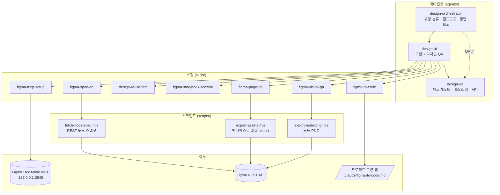
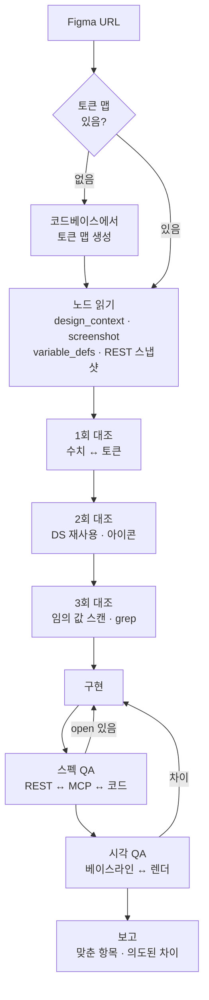

# figma-to-code

Figma 시안을 **어느 디자인 시스템에서든** 토큰 단위로 정확히 옮기고, 수치 교차 검증과 스크린샷 시각 QA까지 끝내게 하는 Claude Code 플러그인입니다.

Figma MCP의 `get_design_context` 를 그대로 쓰면 `text-[15px]`, `bg-[#F5F5F5]`, 관성적인 `gap-8` 같은 값이 남습니다.
실서비스에서 시안 대비 QA를 수십 번 돌리며 반복해서 나온 실수들을 스킬과 에이전트로 묶었습니다.

## 전체 구조



## 작업 흐름

한 화면을 구현할 때 `design-ui` 가 밟는 순서입니다. **3회 대조가 끝나기 전에는 코드를 쓰지 않고**, 두 번의 QA를 통과해야 완료입니다.



### 왜 이렇게 설계했나

| 설계 | 이유 |
|---|---|
| **토큰 맵을 먼저 만든다** | 디자인 시스템마다 토큰 이름·단위가 다르다. 매핑 기준을 파일로 고정해야 에이전트가 추측하지 않는다 |
| **정본을 셋으로 나눈다** | 수치 = REST 스냅샷, 변수 이름 = `get_variable_defs`, 시각 = `get_screenshot`. MCP 참고 코드는 어느 것의 정본도 아니다 |
| **3회 대조 후에만 코드** | 한 번 훑고 바로 짜면 참고 코드의 임의 값이 그대로 남는다 |
| **스펙 QA를 시각 QA 앞에** | 수치 오류를 먼저 걸러야 스크린샷 비교가 "느낌"으로 흐르지 않는다 |
| **시각 QA 게이트** | 토큰 검사가 통과해도 칩 줄바꿈, 일러스트 색, 마지막 슬라이드는 놓친다 ([사례](skills/figma-visual-qa/references/case-missed-qa.md)) |
| **오케스트레이터 → UI → QA** | 구현과 검증을 한 에이전트가 하면 자기 결과를 관대하게 본다. 자급자족 핸드오프 패킷으로 맥락을 넘긴다 |
| **MCP ≠ 항상 정본** | 레이아웃·CMS 때문에 의도적으로 다른 부분은 기록만 하고 억지로 맞추지 않는다 |

## 들어 있는 것

| 종류 | 이름 | 하는 일 |
|---|---|---|
| 에이전트 | `design-orchestrator` | 모드 선택(풀/UI만/QA만/병렬), 핸드오프, 통합 보고 |
| 에이전트 | `design-ui` | 스킬 순서대로 구현하고 두 단계 QA까지 |
| 에이전트 | `design-qa` | 수동 체크리스트, 테스트 갭, 회귀, API 계약 |
| 스킬 | `figma-mcp-setup` | 로컬 Dev Mode MCP 우선 연결, 등록 안 됐을 때 HTTP 직접 호출 |
| 스킬 | `figma-to-code` | 토큰 맵 → 노드 읽기 → 3회 대조 → 구현. [오매핑 원인 9가지](skills/figma-to-code/references/token-mapping.md) |
| 스킬 | `design-reuse-first` | DS·공통 컴포넌트 먼저 찾고, 없을 때만 새로 |
| 스킬 | `figma-storybook-scaffold` | Figma URL로 스토리 계약 먼저, 그다음 구현 |
| 스킬 | `figma-spec-qa` | REST 스냅샷 ↔ MCP ↔ 코드 교차 대조 로그 |
| 스킬 | `figma-visual-qa` | 베이스라인 스크린샷과 나란히. 칩 wrap, 일러스트, 메탈릭 색 |
| 스킬 | `figma-page-qa` | 긴 페이지의 배경 레이어·아이콘 누락 |
| 스크립트 | `fetch-node-spec.mjs` | REST nodes → 평평한 스펙 JSON (텍스트·색·반경·간격·그림자·변수) |
| 스크립트 | `export-assets.mjs` | 매니페스트 하나로 여러 노드 PNG/SVG export ([예시](examples/assets.manifest.json)) |
| 스크립트 | `export-node-png.mjs` | 노드 하나 PNG (REST 또는 TalkToFigma 플러그인) |

```
figma-to-code/
├── .claude-plugin/        plugin.json · marketplace.json
├── agents/                design-orchestrator · design-ui · design-qa
├── skills/
│   ├── figma-mcp-setup/
│   ├── figma-to-code/     references/ token-mapping · token-map-template
│   ├── design-reuse-first/
│   ├── figma-storybook-scaffold/
│   ├── figma-spec-qa/
│   ├── figma-visual-qa/   references/ case-missed-qa
│   └── figma-page-qa/
├── scripts/               fetch-node-spec · export-assets · export-node-png · lib/
└── examples/              assets.manifest.json
```

## 설치

### Claude Code

```
/plugin marketplace add Ahnseungc/figma-to-code
/plugin install figma-to-code@figma-to-code
```

### Cursor · 그 외

`skills/` 를 프로젝트의 `.cursor/skills/` (또는 `.claude/skills/`)로, `agents/` 를 `.cursor/agents/` 로 복사합니다.

### Figma MCP

Figma 데스크톱 앱 → Dev Mode → MCP 서버 켜기 후:

```bash
claude mcp add --transport http figma-desktop http://127.0.0.1:3845/mcp
```

### 스크립트 (선택)

Node 18+. `FIGMA_TOKEN`(Figma → Settings → Personal access tokens)을 환경변수나 `.env.local` 에 넣습니다.

```bash
node scripts/fetch-node-spec.mjs <fileKey> 12:345 specs/figma/12-345.json
node scripts/export-assets.mjs examples/assets.manifest.json
node scripts/export-node-png.mjs <fileKey> 12:345 baseline.png 4
```

## 사용

```
design-orchestrator 로 https://www.figma.com/design/…?node-id=12-345 화면 구현하고 QA까지
```

에이전트 없이 스킬만 써도 됩니다. Figma URL을 붙여 "이 화면 구현해줘"라고 하면 `figma-to-code` 가 실행됩니다.

## 디자인 시스템에 맞추기

처음 실행하면 에이전트가 코드베이스에서 타이포·색·간격·반경·그림자 토큰과 DS 컴포넌트 위치를 찾아
`.claude/figma-to-code.md` 를 만듭니다. 이후 모든 매핑은 이 파일을 기준으로 합니다.
직접 채우려면 [템플릿](skills/figma-to-code/references/token-map-template.md)을 복사하세요.

Tailwind v3/v4, CSS 변수, styled-components theme, 자체 DS 패키지 모두 같은 방식으로 동작합니다.

## 기여

다른 디자인 시스템에서 쓰다가 생긴 오매핑 사례를 PR로 보내 주세요. `token-mapping.md` 표나 QA 체크 항목에 추가합니다.

## License

MIT

---

**English** — A Claude Code plugin (3 agents, 7 skills, 3 scripts) for turning Figma designs into code with exact design-token mapping
for any design system. It builds a project token map first, compares node values in three passes before writing code, cross-checks
the result against a Figma REST snapshot, and finishes with screenshot-based visual QA that catches what token linting misses.
Install with `/plugin marketplace add Ahnseungc/figma-to-code`. Docs are in Korean.
